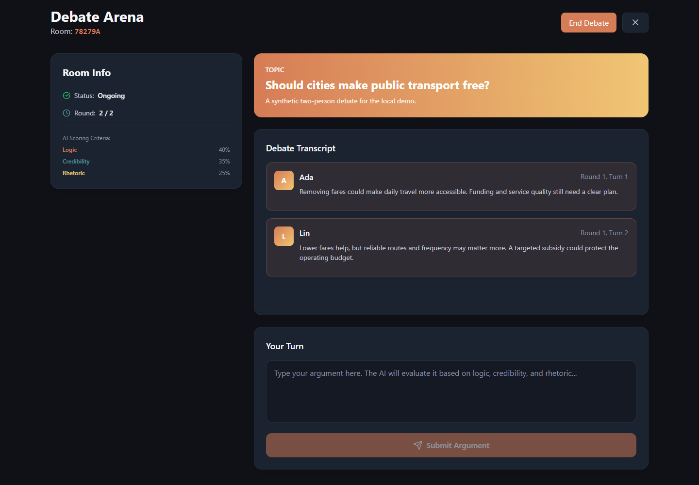
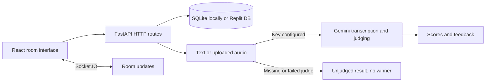

<div align="center">

# Oratio

**A shared room for a debate, with the conversation and its evaluation in one place.**

Take turns, hear the other side, and add a Gemini judge when you connect a provider key.

[](frontend/package.json) [](backend/app/main.py) [](LICENSE)

[**Try text rooms locally**](#start-a-local-text-room) · [**Judging**](#how-the-judge-fits-in) · [**Developer guides**](#developer-guides)

</div>

## Give a discussion a structure

Oratio was built for the Replit Vibeathon to turn a discussion into a room with a topic, participants, rounds and a transcript. Participants submit text or recorded audio, spectators can react, and optional model judging evaluates logic, credibility and rhetoric. The transcript and live room updates keep the exchange visible while it happens.



*Real authenticated local room, synthetic participants and arguments. No provider key was supplied: this capture demonstrates the text exchange, not AI scores or a judged winner.*

| Run the room | Include the audience | Add evaluation when configured |
| --- | --- | --- |
| Topics, individual/team participants, rounds and saved turns | Spectator joins and reactions | Gemini judging, transcription and a training opponent; missing/failed judging stays explicitly unjudged |

## Start a local text room

Install Git and Docker, then build and run a loopback-only demo:

```sh
git clone https://github.com/Muneer320/Oratio.git
cd Oratio
docker build -t oratio-demo .
docker run --rm -p 127.0.0.1:8080:80 -e ORATIO_DB_PATH=/data/oratio.sqlite3 -v oratio-demo-data:/data -v oratio-demo-audio:/app/backend/uploads oratio-demo
```

Open [localhost:8080](http://localhost:8080), register two synthetic users in separate browser sessions, create a text room and join it with both users. Submit a turn from each side. Normal text rooms work without a Gemini key; judging, training opponents and audio transcription need one. The named volumes preserve this example's database/audio after the container stops.

To use provider features, configure a private environment file and add `--env-file backend/.env` to the Docker run command. `GEMINI_API_KEY` enables the configured Gemini integration; optional `SERPER_API_KEY` supplies search leads. Keys and recorded debate data should remain private. This is a local prototype; no public deployment is verified here.

<details>
<summary><strong>Native Python/Vite setup and the existing Compose stack</strong></summary>

Requirements: Python 3.11+, Node.js 22.12+ (or Node.js 24), and a Gemini API key for AI judging, training opponents, and audio transcription.

```bash
cd backend
python -m venv .venv
# Activate .venv for your shell
pip install -r requirements.txt
# Set GEMINI_API_KEY in your environment or backend/.env
uvicorn app.main:socket_app --reload --host 127.0.0.1 --port 8000
```

In another terminal:

```bash
cd frontend
npm ci
npm run dev
```

Open `http://localhost:5000`. The Vite server proxies `/api` and `/socket.io` to the backend. `docker compose up --build` builds the same app behind nginx at `http://localhost:8080`; Compose loads the optional, ignored `backend/.env` file.

Without a key, native normal text rooms still work and results remain unjudged. The standalone Docker example above uses its own named volumes and explicit `/data` path; Compose has separate named volumes and loads the optional ignored `backend/.env` file. Compose's port mapping is not restricted to loopback by its current configuration.

</details>

## How the judge fits in



After a round fills, Gemini receives the topic and earlier turns and returns structured scores from 0 to 10. Final scores weight logic 40%, credibility 35%, and rhetoric 25%. A winner is selected only when every debater has a judged turn and all their turns have valid scores; ties have no winner. If the API key is absent or judging fails, the result says `judged: false` and leaves the winner empty. Serper search, when configured, returns leads for manual fact checking; it does not verify a claim automatically.

Training rooms are identified by topics beginning with `AI Training:`. The AI opponent responds after the human turn. A Gemini key is required for this mode.

> [!IMPORTANT]
> Model scores are an evaluation aid, not an objective verdict. Search leads do not prove a claim. Submitted text/audio may be sent to the configured provider; use synthetic material when demonstrating the app.

<details>
<summary><strong>Storage, sessions, room membership and deployment limits</strong></summary>

The backend uses Replit DB when available. Outside Replit it stores accounts, sessions, rooms, and turns in `backend/data/oratio.sqlite3`. Docker Compose keeps the SQLite file and uploaded audio in named volumes. Uploaded audio is available to room members through an authenticated API route. A multi-instance deployment would need shared storage and a coordinated real-time backend.

Local passwords use scrypt hashes and login sessions expire after seven days. Existing plaintext records are upgraded when their owners log in. Debate transcripts, status, and results require a valid session and room membership. Socket.IO room joins enforce the same membership check.

The standalone Docker example overrides the default SQLite path with `/data/oratio.sqlite3`. Runtime database/audio directories and environment files are excluded from the image build context. Authentication is implemented, but the project has not established a production multi-instance or independent security-validation claim.

</details>

<details>
<summary><strong>Active HTTP/Socket.IO routes and incomplete prototype flows</strong></summary>

FastAPI documents the active routes at `/docs`. Common routes include `/api/auth/register`, `/api/auth/login`, `/api/rooms/create`, `/api/rooms/code/{code}`, `/api/participants/join`, `/api/spectators/join`, `/api/debate/{room_id}/submit-turn`, `/api/debate/{room_id}/submit-audio`, `/api/debate/{room_id}/status`, `/api/debate/{room_id}/transcript`, `/api/debate/{room_id}/end`, and `/api/ai/summary/{room_id}`. Socket.IO uses `/socket.io/`; clients send their bearer token in the Socket.IO `auth` payload and emit `join_room` with a `room_id`. There are no `/ws/*` routes.

The frontend uses the room, debate, and auth routes. Trainer challenge and resource upload routes are exposed but are prototype features without complete frontend flows. Audio recording uses the browser MediaRecorder API; transcription requires Gemini. See [API documentation](API_DOCUMENTATION.md) and [quick start](QUICKSTART.md).

</details>

## Developer guides

| Run and understand | Verify and contribute |
| --- | --- |
| [Native quickstart](QUICKSTART.md) | [Backend tests](backend/tests/) |
| [API documentation](API_DOCUMENTATION.md) | [Frontend scripts](frontend/package.json) |
| [Backend application](backend/app/main.py) | [MIT license](LICENSE) |

From `backend`, run `python -m unittest discover -s tests -v`. From `frontend`, run `npm run build` and inspect `npm audit` results. For a focused PR, exercise the affected room/member flow and update the API/setup docs when it changes. Report bugs with synthetic room/turn data in [Issues](https://github.com/Muneer320/Oratio/issues); do not attach credentials or private recordings.

Built for the Replit Vibeathon; original contributions and history are preserved. [MIT license](LICENSE).
